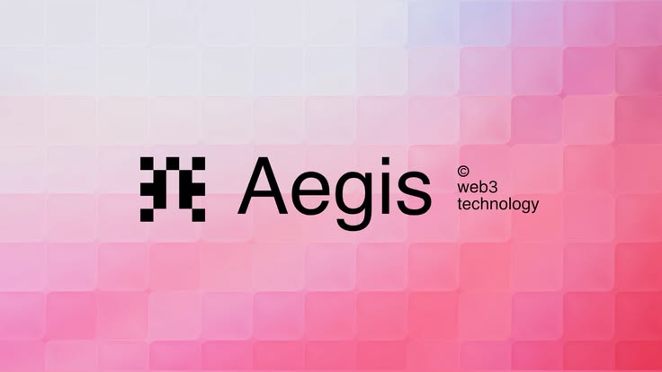
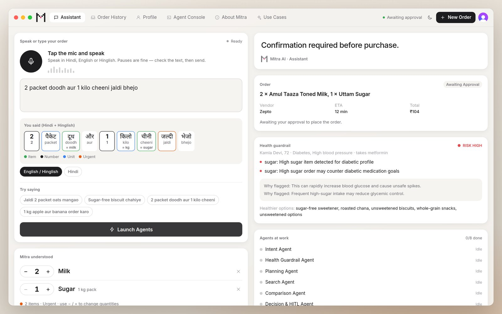
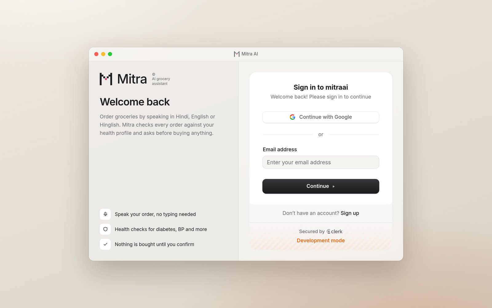
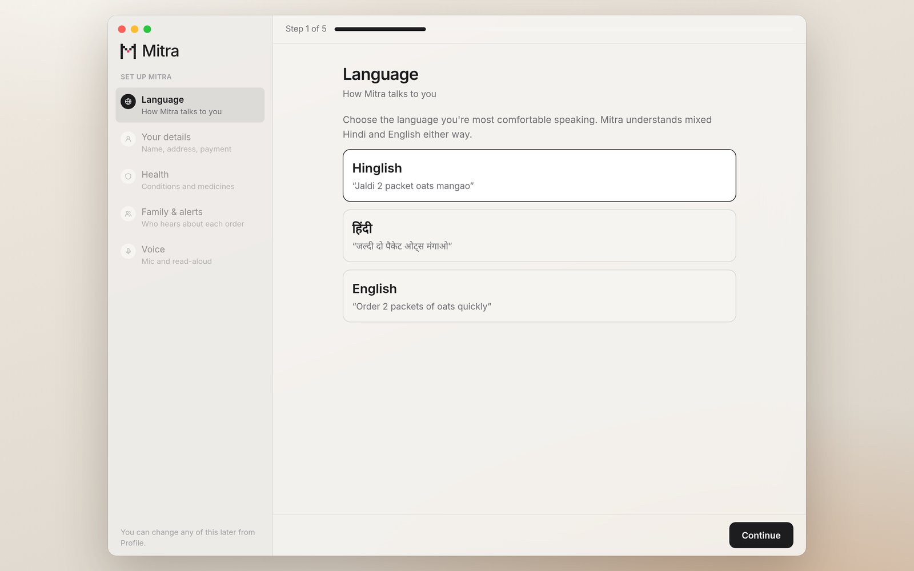
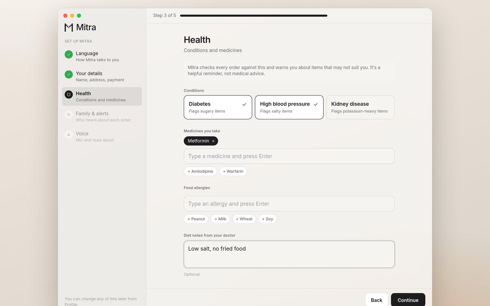
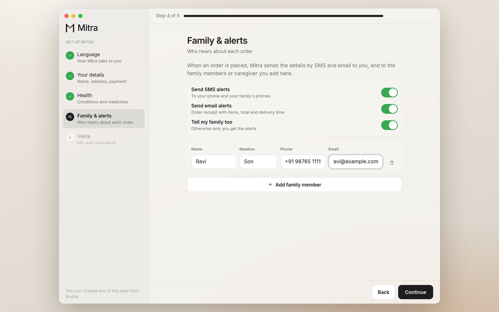
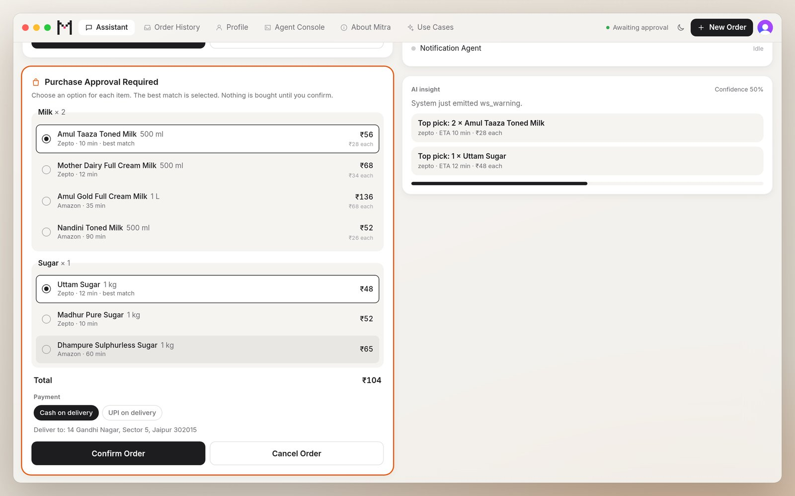
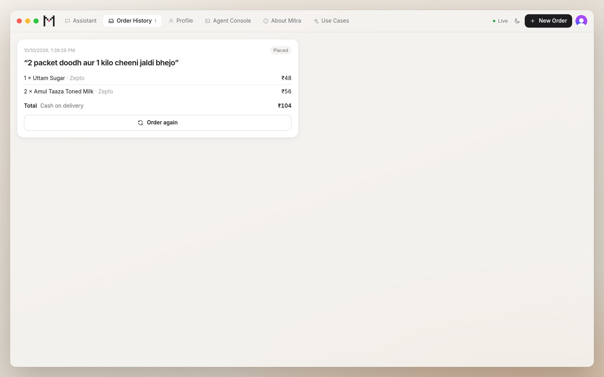
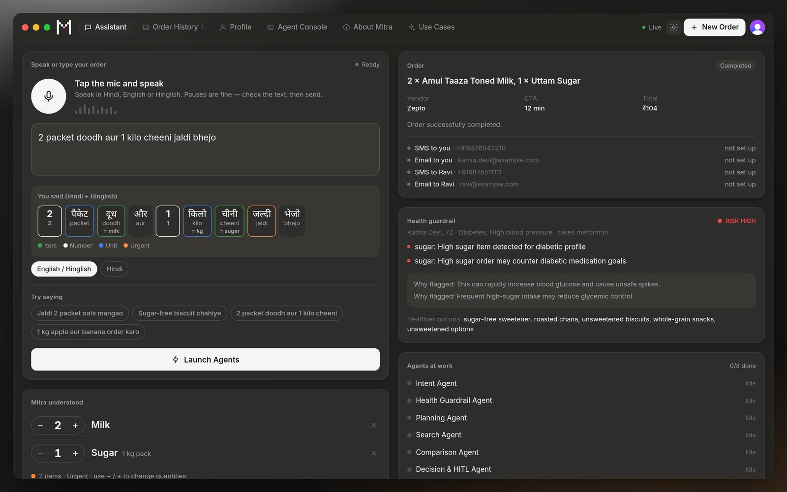

<div align="center">



# Mitra AI

**Multi-agent Intent Translator and Retail Assistant**

A voice-first grocery assistant for elderly users in India. Speak an order in Hindi, English or Hinglish,
and Mitra turns it into a safe, confirmed purchase, checked against your own health profile.




</div>

---

## Contents

- [Why Mitra](#why-mitra)
- [Features](#features)
- [Screenshots](#screenshots)
- [How it works](#how-it-works)
- [Tech stack](#tech-stack)
- [Getting started](#getting-started)
- [Configuration](#configuration)
- [API reference](#api-reference)
- [Voice input](#voice-input)
- [Testing](#testing)
- [Troubleshooting](#troubleshooting)
- [Demo walkthrough](#demo-walkthrough)
- [Disclaimer and contact](#disclaimer-and-contact)

## Why Mitra

Grocery apps assume fast typing, small buttons and English menus. Many older adults in India would rather just
*say* what they need, often in a mix of Hindi and English, and many manage conditions such as diabetes or high
blood pressure that make some purchases risky.

Mitra lets them order by voice in their own words, checks every order against their health profile, compares
options across stores, and **never buys anything until the user confirms**. Family members can be alerted about
every order.

## Features

| | |
|---|---|
| **Voice-first ordering** | Speak or type in Hindi, English or Hinglish. Words are highlighted as item, number, unit or urgency, and nothing is sent until you check the text. |
| **Personal health guardrails** | Each order is checked against the user's own conditions, medicines and allergies, with a clear risk level, the reason it was flagged and healthier alternatives. |
| **8-agent LangGraph pipeline** | Intent → health → planning → search → comparison → decision → purchase → notification. |
| **Human-in-the-loop approval** | The graph pauses before purchase. The user picks a product for each item and a payment method, then confirms or cancels. |
| **Safe purchasing** | Idempotency keys prevent duplicate orders, and a per-agent audit log records every step. |
| **Payments** | Cash or UPI on delivery, plus optional online payment through Razorpay with server-side signature verification and automatic refunds. |
| **Family alerts** | Order receipts by email (Resend) and SMS (Twilio) to the user and their family contacts. |
| **Accounts and profiles** | Clerk sign-in, a 5-step onboarding, and one profile per user stored in Supabase Postgres. |
| **Live agent timeline** | Agent events streamed over WebSocket through Redis. |
| **Polished UI** | macOS-style interface with dark mode, order history and one-tap **Order again**. |

> **Note:** store search (Zepto, Amazon) is simulated through mock MCP clients, so no real orders are placed with those stores.

## Screenshots

<table>
  <tr>
    <td width="50%"><p align="center"><b>Sign in</b>, secured by Clerk</p></td>
    <td width="50%"><p align="center"><b>Onboarding</b>: choose a language</p></td>
  </tr>
  <tr>
    <td><p align="center"><b>Health profile</b>: conditions, medicines, allergies</p></td>
    <td><p align="center"><b>Family and alerts</b>: who hears about each order</p></td>
  </tr>
  <tr>
    <td><p align="center"><b>Assistant</b>: a Hinglish order flagged as high risk for a diabetic user</p></td>
    <td><p align="center"><b>Purchase approval</b>: compare options, choose payment, confirm</p></td>
  </tr>
  <tr>
    <td><p align="center"><b>Order history</b> with one-tap reorder</p></td>
    <td><p align="center"><b>Dark mode</b></p></td>
  </tr>
</table>

## How it works

### User flow

1. **Sign up or sign in** (`/sign-in`, `/sign-up`) with Clerk. Every other page requires a session.
2. **Onboarding** (first visit only), in five steps: Language → Your details (name, age, phone, address, stores,
   payment) → Health (conditions, medicines, allergies, diet notes) → Family contacts → Voice (mic test and read-aloud).
3. **Assistant:** speak or type an order. It is checked against *this user's* health profile, and the payment
   method is chosen on the approval card.
4. **Order history:** past orders from the database, with **Order again**. **Profile** lets you edit any onboarding step.

### Agent pipeline (FastAPI + LangGraph)

| # | Agent | Responsibility |
|---|---|---|
| 1 | Intent | Parses free-form Hindi/English/Hinglish into items, quantities, units and urgency |
| 2 | Health & Memory Guardrail | Checks items against the user's conditions, medicines and allergies, and blocks bulk orders |
| 3 | Planning | Builds the shopping plan |
| 4 | Search | Queries stores through (simulated) MCP clients |
| 5 | Comparison | Ranks options by price, delivery time and fit |
| 6 | Decision & HITL | Pauses the graph and waits for the user's approval |
| 7 | Purchase | Places the order with retries and an idempotency key |
| 8 | Notification | Sends email and SMS alerts to the user and their family |

### Frontend (Next.js)

- **Assistant:** voice and text input, a "Mitra understood" card, the order summary, the health guardrail and
  agent progress.
- **Order History**, **Profile**, **Agent Console** (live WebSocket timeline), **About Mitra** and **Use Cases** tabs.
- Hydration-safe theme handling with a saved dark-mode preference.

### Repository structure

```text
backend/
  app/
    agents/      # LangGraph agent nodes
    api/         # REST + WebSocket routes (orders, profile, voice, ws)
    core/        # config, database, Clerk auth
    graph/       # workflow and shared state
    services/    # LLM, MCP clients, payments, alerts, speech-to-text, Redis
  tests/
frontend/
  app/           # Next.js App Router pages (sign-in, sign-up, home)
  components/    # Assistant, onboarding, auth shell, icons
  lib/           # profile API, Razorpay, transliteration, voice input hook
docs/screenshots/
docker-compose.yml
```

## Tech stack

| Layer | Technology |
|---|---|
| Backend | Python 3.11+, FastAPI, LangGraph, LangChain, SQLAlchemy |
| Frontend | Next.js 14 (App Router), React 18, Tailwind CSS, Web Speech API |
| Auth | Clerk (frontend sign-in; the backend verifies session tokens against Clerk's JWKS) |
| Data | Supabase Postgres (SQLite fallback for local development), Redis event stream |
| Voice | Browser speech recognition, OpenAI transcription or offline Vosk models |
| Payments and alerts | Razorpay, Resend (email), Twilio (SMS) |
| Infrastructure | Docker, Docker Compose |

## Getting started

### Option A: Docker (recommended)

**Prerequisites:** Docker Desktop running, and ports `3000` (frontend), `8000` (backend), `6379` (Redis) and
`5432` (Postgres) free. If `5432` is taken, map the database to `5433:5432` in `docker-compose.yml`.

```bash
git clone https://github.com/dishadutta04/MitraAI.git
cd MitraAI
cp backend/.env.example backend/.env
cp frontend/.env.example frontend/.env.local
docker compose up --build
```

- Frontend: <http://localhost:3000>
- Backend health check: <http://localhost:8000/health>

### Option B: Run locally

```bash
# Backend
cd backend
python -m venv .venv && source .venv/bin/activate
pip install -r requirements.txt
uvicorn app.main:app --reload --port 8000

# Frontend (in a second terminal)
npm --prefix frontend install
npm --prefix frontend run dev
```

Without `DATABASE_URL`, the backend uses a local SQLite file (`backend/mitra_ai.db`). Without Clerk keys, Clerk
runs in *keyless* development mode with temporary keys.

## Configuration

Copy the example files and fill in only what you need. Every integration is optional except sign-in.

### Backend: `backend/.env`

| Variable | Purpose |
|---|---|
| `DATABASE_URL` | Supabase session-pooler connection string (SQLite if unset) |
| `CLERK_PUBLISHABLE_KEY` | Same key as the frontend; used to verify session tokens |
| `CLERK_AUTHORIZED_PARTIES` | Allowed frontend origins, e.g. `http://localhost:3000` |
| `RAZORPAY_KEY_ID`, `RAZORPAY_KEY_SECRET` | Enables "Pay now (UPI / card)" |
| `RESEND_API_KEY`, `ALERT_EMAIL_FROM` | Email order alerts |
| `TWILIO_ACCOUNT_SID`, `TWILIO_AUTH_TOKEN`, `TWILIO_FROM_NUMBER` | SMS order alerts |
| `REDIS_URL` | Live agent timeline |
| `LLM_PROVIDER` | `mock` (built-in rules, no key) or `openai` |
| `OPENAI_API_KEY` | Optional; used by the OpenAI provider and for voice transcription |
| `VOSK_MODELS_DIR` | Location of the offline speech models |

### Frontend: `frontend/.env.local`

| Variable | Purpose |
|---|---|
| `NEXT_PUBLIC_API_BASE_URL` | Backend URL (default `http://localhost:8000`) |
| `NEXT_PUBLIC_CLERK_PUBLISHABLE_KEY`, `CLERK_SECRET_KEY` | Clerk application keys |

<details>
<summary><b>Clerk setup</b></summary>

1. Create an application at [dashboard.clerk.com](https://dashboard.clerk.com) and enable Email and/or Phone sign-in.
2. Add `NEXT_PUBLIC_CLERK_PUBLISHABLE_KEY` and `CLERK_SECRET_KEY` to `frontend/.env.local`.
3. Add the same publishable key to `backend/.env` as `CLERK_PUBLISHABLE_KEY` (the backend derives the issuer
   from it), and set `CLERK_AUTHORIZED_PARTIES` to the frontend origin(s).

</details>

<details>
<summary><b>Supabase setup</b></summary>

1. Create a project at [supabase.com](https://supabase.com).
2. Go to **Connect**, copy the **Session pooler** connection string, and add it to `backend/.env` as `DATABASE_URL`.
3. Start the backend. Tables are created on startup, existing tables gain any new columns, and row-level security
   is switched on with no policies, so Supabase's public API keys cannot read health data. Only the backend's
   database connection can.

</details>

<details>
<summary><b>Online payment (Razorpay)</b></summary>

1. Sign up at [dashboard.razorpay.com](https://dashboard.razorpay.com), stay in **Test mode**, and generate a key
   under **Account & Settings → API Keys**.
2. Set `RAZORPAY_KEY_ID=rzp_test_...` and `RAZORPAY_KEY_SECRET` in `backend/.env`.
3. **Pay now (UPI / card)** then appears in onboarding and on the approval card. The server computes the amount,
   creates a Razorpay order, verifies the payment signature, and places the order for exactly the items paid
   for. If the purchase fails after payment, the payment is refunded.
4. Use Razorpay's [test cards and UPI IDs](https://razorpay.com/docs/payments/payments/test-card-details/)
   (e.g. `success@razorpay`). Switch to live keys only after your account is activated (KYC).

</details>

<details>
<summary><b>Order alerts (email and SMS)</b></summary>

Each channel stays off until its keys are set, and a failed alert never affects the order.

- **Email (Resend):** create an API key at [resend.com](https://resend.com). Until you verify a domain, Resend only
  delivers from `onboarding@resend.dev` to your own account email.
- **SMS (Twilio):** set the account SID, auth token and a Twilio number from
  [console.twilio.com](https://console.twilio.com). Trial accounts only text verified numbers, and sending to
  Indian numbers in production requires DLT registration.

</details>

## API reference

Every endpoint except `/health` and `/api/v1/voice/status` requires `Authorization: Bearer <Clerk session token>`
(WebSockets take it as `?token=`). The user is always taken from the token, never from the request body.

| Method | Endpoint | Description |
|---|---|---|
| `GET` | `/api/v1/profile/me` | The signed-in user's profile (`404` until onboarding is complete) |
| `PUT` | `/api/v1/profile/me` | Create or update the profile |
| `POST` | `/api/v1/orders/parse` | Parse text into items, quantities and urgency |
| `POST` | `/api/v1/orders/start` | Start an order; returns `awaiting_confirmation` or `completed` |
| `POST` | `/api/v1/orders/{thread_id}/resume` | Approve or reject a paused order |
| `GET` | `/api/v1/orders/history` | The user's placed orders, newest first |
| `GET` | `/api/v1/orders/payment-config` | Whether online payment is enabled |
| `POST` | `/api/v1/orders/{thread_id}/payment` | Create a Razorpay order for a paused order |
| `POST` | `/api/v1/voice/transcribe` | Transcribe 16 kHz mono WAV audio |
| `WS` | `/ws/events/{thread_id}?token=…` | Live agent events (only for the user who started the order) |

**Start an order**

```json
POST /api/v1/orders/start
{ "message": "jaldi 2 packet oats mangao" }
```

**Resume an order**

```json
POST /api/v1/orders/{thread_id}/resume
{ "approved": true, "payment_method": "cod" }
```

**WebSocket event**

```json
{ "event": "agent_completed", "agent_name": "Intent Agent", "data": {}, "thread_id": "..." }
```

## Voice input

- One mode covers Hindi, English and Hinglish. Recognition runs in `hi-IN`, which also understands English words.
- Text can be shown in Roman script (`jaldi do packet oats`) or Devanagari (`जल्दी दो पैकेट ओट्स`).
- Nothing is sent automatically. The text stays editable alongside a **Mitra understood** card, and can be read
  back aloud.
- Works in every modern browser:
  - **Chrome, Edge, Safari:** the browser's built-in speech recognition, with words appearing live.
  - **Firefox, Brave and others:** audio is recorded in the page and transcribed by the backend, using OpenAI if
    `OPENAI_API_KEY` is set, otherwise offline Vosk models. Hindi and Indian-English models both run, and the
    transcript with the most recognisable grocery words wins.

Docker downloads the offline models automatically. For a local setup:

```bash
cd backend && mkdir -p models && cd models
curl -LO https://alphacephei.com/vosk/models/vosk-model-small-hi-0.22.zip && unzip vosk-model-small-hi-0.22.zip
curl -LO https://alphacephei.com/vosk/models/vosk-model-small-en-in-0.4.zip && unzip vosk-model-small-en-in-0.4.zip
```

## Testing

```bash
cd backend
pip install -r requirements-dev.txt
python -m pytest -q tests
```

### Data model notes

- One `user_profiles` row per Clerk user (id = Clerk user id), written during onboarding.
- The orders table has a unique idempotency key to prevent duplicate purchases.
- The audit log records each agent's events and payloads.

## Troubleshooting

| Problem | Fix |
|---|---|
| Next.js hydration error | Browser-only checks run in `useEffect`, and `<html>` has `suppressHydrationWarning` |
| Port `5432` already allocated | Map the database to `"5433:5432"` in `docker-compose.yml` |
| `next: command not found` | Install frontend dependencies: `npm --prefix frontend install` |
| "Redis unavailable, live stream limited" | Start Redis (`docker compose up redis`) or set `REDIS_URL`; orders still work without it |

## Demo walkthrough

A 2–3 minute demo:

1. Sign in and walk through onboarding, adding *Diabetes* as a condition.
2. Say or type **"2 packet doodh aur 1 kilo cheeni jaldi bhejo"**.
3. Show how each word is understood and the **high-risk** health flag on sugar, with healthier alternatives.
4. On the approval card, compare products, choose a payment method and **Confirm Order**.
5. Open **Order History**, use **Order again**, and switch to dark mode.
6. Open **Agent Console** to show the live agent timeline.

## Disclaimer and contact

Mitra AI is a demonstration project. Its recommendations are assistive: always check order details before
confirming. Health guardrails are general reminders and **do not replace medical advice**.

**Founding team:** Disha Dutta · [dishadutta61@gmail.com](mailto:dishadutta61@gmail.com) · [GitHub](https://github.com/dishadutta04)
